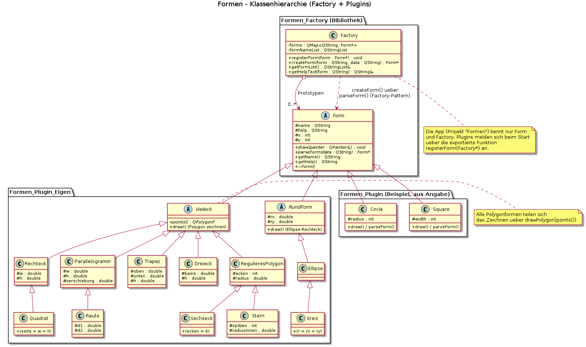

# Formen – Factory-Pattern mit Plugins (Qt)

Mit Qt Creator öffnen: `Formen.pro` (Subdirs-Projekt) → Kit → Build & Run.
Bau-Reihenfolge ist durch `CONFIG += ordered` geregelt:
**Formen_Factory → Formen_Plugin (Beispiel) → Formen_Plugin_Eigen → Formen (App)**.

## Projektstruktur
| Projekt | Rolle |
|---|---|
| `Formen_Factory/` | Bibliothek (`TEMPLATE = lib`): abstrakte Basisklasse `Form` + `Factory` (Factory-Pattern, registerForm/createForm) |
| `Formen_Plugin/` | Beispiel-Plugin aus der Angabe (Stelle Kreis + Square bereit) |
| `Formen_Plugin_Eigen/` | **Eigenes Plugin**: registriert 11 weitere Formen (Rechteck, Quadrat, Kreis, Ellipse, Trapez, Parallelogramm, Raute, Dreieck, Polygon, Sechseck, Stern) |
| `Formen/` | App: lädt beim Start alle Plugins aus `../plugins` (QLibrary + `resolve("registerForm")`), Formen werden per `QPainter` im `paintEvent` gezeichnet |

Beide Plugin-DLLs landen im Build-Ordner `plugins/`, die Factory-DLL wird von der
Factory-Bibliothek direkt ins Build-Verzeichnis der App ausgegeben (`DESTDIR`).

## Klassenhierarchie (UML)
Siehe [`uml/Formen.puml`](uml/Formen.puml) (PlantUML-Quelle) und gerendertes Bild:

Wichtige Abstraktionen:
- `Vieleck` (abstrakt): alles mit Ecken → gemeinsames `drawPolygon(points())`
- `RundForm` (abstrakt): Ellipsoid-Basis → gemeinsames `drawEllipse(...)`
- **Quadrat ist ein Rechteck** mit `seite = w = h`; **Kreis ist eine Ellipse** mit `rx = ry`
- `Sechseck`/`Stern` sind spezialfälle von `RegulieresPolygon`
- `Raute` ist ein `Parallelogramm` (über Diagonalen definiert)

## Bedienung
Form auswählen → das Hilfe-Label zeigt das Datenformat → z.B.
`200,300,80` für Kreis (x,y,radius) → **Erstellen**. Mehrere Formen stapeln sich,
**Alle loeschen** leert die Zeichenfläche.

## Beispieleingaben
| Form | Daten |
|---|---|
| Rechteck | `50,50,120,70` |
| Quadrat | `200,60,80` |
| Kreis | `400,200,60` |
| Ellipse | `400,200,90,50` |
| Trapez | `100,400,60,140,70` |
| Parallelogramm | `300,400,120,70,40` |
| Raute | `550,300,120,80` |
| Dreieck | `50,500,120,90` |
| Polygon | `600,450,7,60` |
| Sechseck | `300,200,50` |
| Stern | `450,150,5,60,25` |

## Abweichungen/Verbesserungen gegenüber dem Schulbeispiel
- Keine kopierte `sdk/`-Ordnerstruktur: alle Projekte referenzieren die Header der
  Factory direkt (`INCLUDEPATH += ../Formen_Factory`) – eine Quelle, keine veralteten Kopien.
- `Form` hat einen virtuellen Destructor; die Factory gibt ihre Prototypen im
  Destructor frei (im Schulbeispiel nur als Rohfassung).
- `getHelpText()` prueft `contains()` statt blind zu `find()`en.
- Plugin-Suche funktioniert plattformuebergreifend (`*.dll`, `*.so`, `*.dylib`) und
  haelft die Bibliotheken bis zum Programmende offen.
